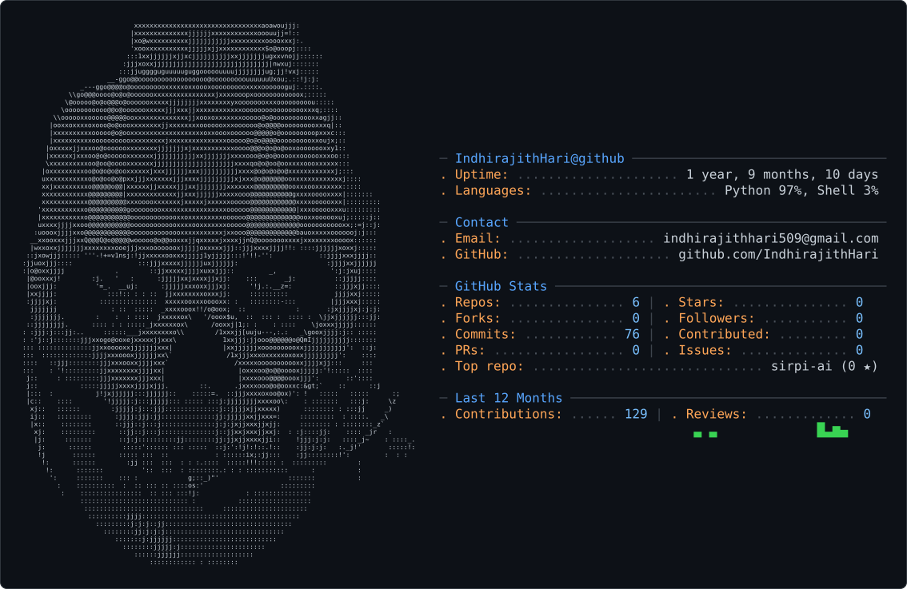

<div align="center">

  <!-- Dynamic Typing Title -->
  <a href="https://github.com/IndhirajithHari">
    
  </a>

  <br/>

  <!-- Dual-Theme ASCII Profile Card -->
  <picture>
    <source media="(prefers-color-scheme: dark)" srcset="https://raw.githubusercontent.com/IndhirajithHari/IndhirajithHari/main/assets/dark_mode.svg">
    <source media="(prefers-color-scheme: light)" srcset="https://raw.githubusercontent.com/IndhirajithHari/IndhirajithHari/main/assets/light_mode.svg">
    
  </picture>

  <br/><br/>

  <!-- Status Badges -->
  <p align="center">
    <a href="mailto:indhirajithhari509@gmail.com">
      
    </a>
    <a href="https://buymeacoffee.com/indhirajith">
      
    </a>
    
    
  </p>

  <!-- Live Telemetry Badges -->
  <p align="center">
    
    
    
  </p>

</div>

---

### ⚡ System Specifications (`$ neofetch --profile`)

```bash
╭─ indhirajith@silicon-lab ~ 
╰─$ neofetch
       .---.            User: Indhirajith Hari (INDHIRAJITH)
      /     \           Host: Hardware & Systems Architecture Lab
     | () () |          Degree: B.Tech
      \  -  /           Target Arch: RISC-V | Custom GPU | x86_64
       '---'            Specialties: ASIC Physical Design, Compilers, OS Kernels
                        Kernel: agam-kernel / Linux
                        Shell: zsh / bash
                        Philosophy: "LOVE TO INVENT — do or die, but don't cry.!"
```

---

### 🛠️ Technical Arsenal & Weaponry

<div align="center">

| Domain | Technologies & Tools |
| :--- | :--- |
| **Silicon & VLSI Design** | `Verilog` `SystemVerilog` `RISC-V` `OpenLane` `OpenROAD` `Yosys` `Magic VLSI` `KLayout` |
| **Systems & Low-Level** | `C` `C++` `Rust` `x86/ARM Assembly` `Linux Kernel Dev` `QEMU` `GDB` `Make / CMake` |
| **AI, Compilers & Languages** | `Python` `PyTorch` `Deep Learning Agents` `CUDA` `Compiler Design (mathi)` `Streamlit` |
| **Tooling & Infrastructure** | `Docker` `Git` `Linux (Fedora / Arch)` `EDA Workflows` `VS Code` `Bash Scripting` |

<br/>

<!-- Shields Badges Matrix -->
<p>
  
  
  
  
  
  
  
  
  
</p>

</div>

---

### 🚀 Flagship Research & Projects

<table>
  <tr>
    <td width="50%" valign="top">
      <h3 align="center">🧠 <a href="https://github.com/IndhirajithHari/neuro-silicon">neuro-silicon</a></h3>
      <p align="center"><b>Autonomous AI Floor Planning Agent for ASIC Physical Design</b></p>
      <ul>
        <li>Automated macro placement, floorplanning optimization, and physical synthesis.</li>
        <li>Integrates directly with the OpenLane ASIC flow and open-source EDA tooling.</li>
        <li><i>Stack:</i> Python, OpenLane, Yosys, KLayout, AI Agents.</li>
      </ul>
    </td>
    <td width="50%" valign="top">
      <h3 align="center">⚡ <a href="https://github.com/IndhirajithHari/mathi">mathi</a></h3>
      <p align="center"><b>Domain-Specific GPU Programming Language & Runtime</b></p>
      <ul>
        <li>Custom programming language designed specifically for accelerated parallel GPU compute.</li>
        <li>Focuses on concise syntax, tensor operations, and hardware execution efficiency.</li>
        <li><i>Stack:</i> Python, GPU Architectures, Compiler Design.</li>
      </ul>
    </td>
  </tr>
  <tr>
    <td width="50%" valign="top">
      <h3 align="center">🛡️ <a href="https://github.com/IndhirajithHari/agam-kernel">agam-kernel</a></h3>
      <p align="center"><b>Custom UNIX-like Operating System Kernel from Scratch</b></p>
      <ul>
        <li>Bare-metal operating system kernel built in C.</li>
        <li>Implements low-level memory management, process scheduling, and hardware abstraction.</li>
        <li><i>Stack:</i> C, Assembly, QEMU, Linker Scripts, OS Internals.</li>
      </ul>
    </td>
    <td width="50%" valign="top">
      <h3 align="center">🤖 <a href="https://github.com/IndhirajithHari/sirpi-ai">sirpi-ai</a></h3>
      <p align="center"><b>Next-Generation Intelligent AI Agent Framework</b></p>
      <ul>
        <li>Modular, high-performance agent architecture for code generation and multi-modal problem solving.</li>
        <li>Designed with rapid prototyping and extensible tool integration.</li>
        <li><i>Stack:</i> Python, LLM Reasoning, Tool APIs.</li>
      </ul>
    </td>
  </tr>
  <tr>
    <td width="100%" colspan="2" valign="top">
      <h3 align="center">📐 <a href="https://github.com/IndhirajithHari/PAA-ISA">PAA-ISA</a> & <a href="https://github.com/IndhirajithHari/INAI">INAI</a></h3>
      <p align="center"><b>Custom Instruction Set Architecture & GPU Microarchitecture Design</b></p>
      <p align="center">Exploring hardware-software co-design with custom instruction sets, microarchitectural execution pipelines, and silicon implementations.</p>
    </td>
  </tr>
</table>

<br/>

<details>
  <summary><b>📐 Click to Expand: Systems & Silicon Architecture Specifications</b></summary>
  <br/>

  #### 🧠 `neuro-silicon` AI Floorplan Workflow
  ```
  [Verilog RTL] ──▶ [Yosys Synthesis] ──▶ [AI Floorplanning Agent] ──▶ [OpenLane / KLayout]
                                                    │
                                  ┌─────────────────┴─────────────────┐
                                  ▼                                   ▼
                       Macro Placement Strategy             Congestion & Wirelength Optimization
  ```

  #### 🛡️ `agam-kernel` Boot Pipeline
  ```
  [OpenSBI / Firmware] ──▶ [_start Kernel Entry] ──▶ [4-Level Paging] ──▶ [Task Scheduler] ──▶ [Ring 3 Userland]
  ```

  #### ⚡ `PAA-ISA` Microarchitecture Highlights
  * **Base Core:** 64-bit RISC-V RV64GC-compatible execution pipeline.
  * **Accelerators:** Custom hardware execution units tuned for parallel tensor and matrix operations.
  * **Synthesis Target:** SkyWater 130nm process design kit (PDK) via OpenROAD & Magic.

</details>

---

### 📊 Telemetry & Contribution Activity

<div align="center">

  <!-- Stats Grid -->
  <table border="0">
    <tr>
      <td>
        
      </td>
      <td>
        
      </td>
    </tr>
  </table>

  <!-- Streak Stats -->
  <p align="center">
    
  </p>

</div>

---

### 🎮 Retro Arcade: Cyber-Snake Eating My 72-Day Streak

<div align="center">

  <p>
    
    
    
  </p>

  <picture>
    <source media="(prefers-color-scheme: dark)" srcset="https://raw.githubusercontent.com/IndhirajithHari/IndhirajithHari/output/github-contribution-grid-snake-dark.svg">
    <source media="(prefers-color-scheme: light)" srcset="https://raw.githubusercontent.com/IndhirajithHari/IndhirajithHari/output/github-contribution-grid-snake.svg">
    
  </picture>

  <p>
    <sub>🐍 <i>The cyber-snake patrols the contribution grid, consuming commits to power the streak!</i> 👾</sub>
  </p>

</div>

---

### 💖 Support & Fuel the Inventions

<div align="center">

<p>
  If you find my silicon EDA tools (<b>neuro-silicon</b>), GPU language (<b>mathi</b>), or bare-metal OS kernels (<b>agam-kernel</b>) valuable, consider fueling the late-night architecture and debugging sessions! ☕⚡
</p>

<a href="https://buymeacoffee.com/indhirajith" target="_blank">
  
</a>

<br/><br/>

[](https://buymeacoffee.com/indhirajith)

</div>

---

### 💬 Fortune Cookie & Hacker Philosophy

```bash
$ cat ~/.mindset
"do or die - but don't cry.!"

$ fortune | cowsay -f ghost
 _________________________________________
/ LOVE TO INVENT.                         \
\ The future is silicon, AI, and kernels. /
 -----------------------------------------
        \   .-.
         \ (o o)
            |O \
             \  \
              `~~~'

$ echo "Thanks for visiting! Leave a ⭐ on my projects if you find them interesting."
```

---

<div align="center">
  <sub>Engineered by <b>Indhirajith Hari</b> • Powered by Open Source Silicon, Kernels & Neural Architectures</sub>
</div>
